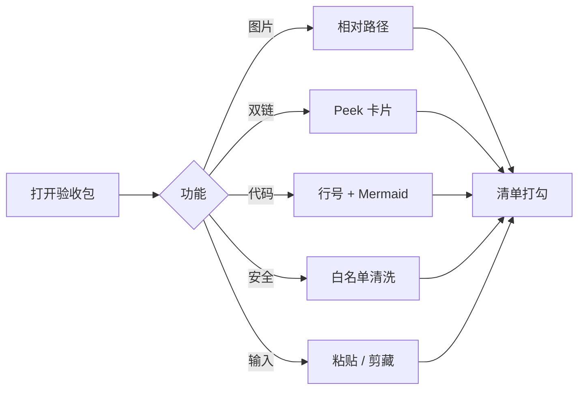

# 行号与 Mermaid

## 代码行号

下面这块多行 TypeScript，预览左侧应有行号；点「复制」得到的源码**不含**行号。

```ts
type Document = {
  id: string;
  path: string;
  type: "md" | "html";
  content: string;
};

function save(doc: Document) {
  localStorage.setItem("langhuan:" + doc.id, JSON.stringify(doc));
}

const demo: Document = {
  id: "1",
  path: "笔记/示例.md",
  type: "md",
  content: "# hello",
};

save(demo);
```

## Mermaid 流程图



工具栏可切「源码」查看围栏原文，或复制。

相关：[[README]] · [[安全白名单]]
