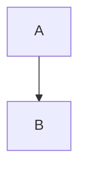

# 标题 Hello

段落 one with **bold** and `code` and [link](https://ex.com).

## 列表

- item alpha
  - nested beta
- item gamma

1. first
2. second

- [ ] todo unchecked
- [x] todo checked

> A blockquote line

| ColA | ColB |
| ---- | ---- |
| cell1 | cell2 |

```js
const x = 1;
console.log(x);
```

$$
E = mc^2
$$

Inline $a+b$ math.




Emoji 🎉 and 中英文 mix OK.

